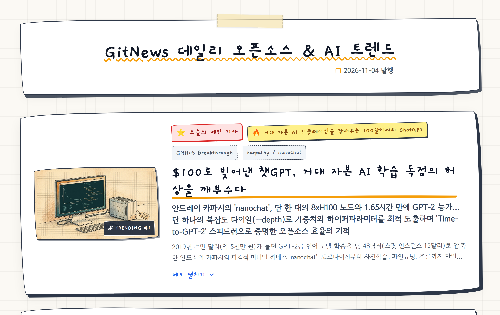
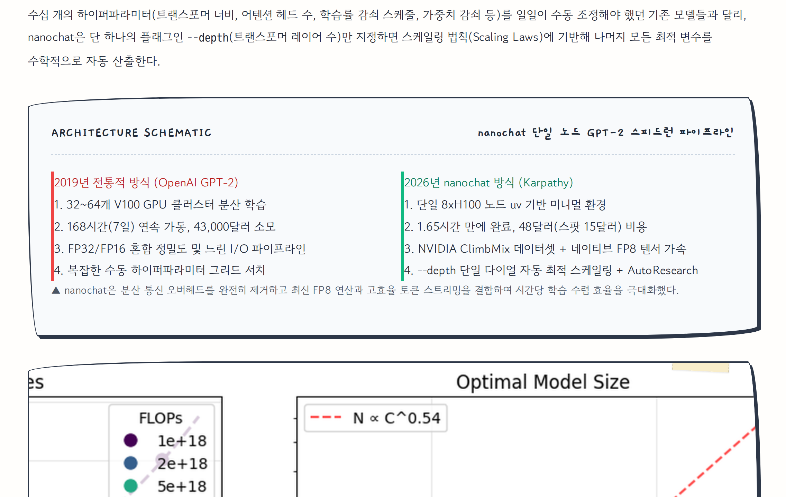
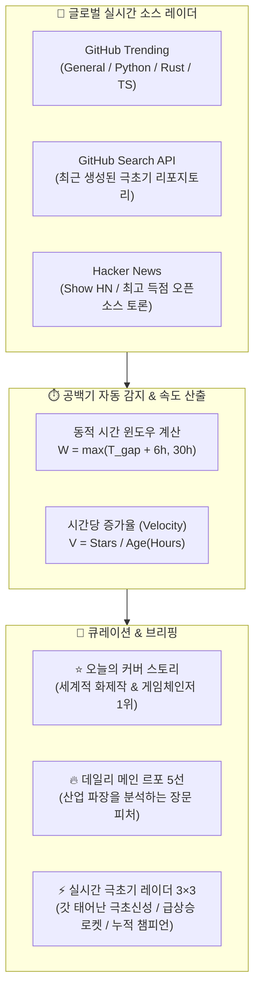
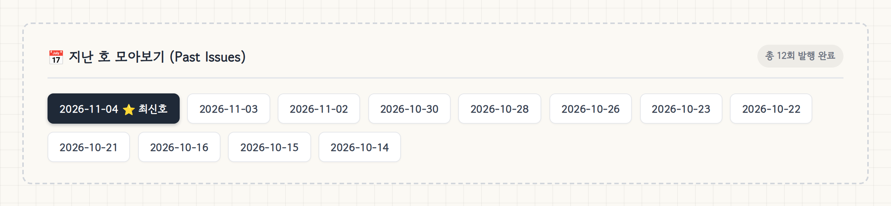

<div align="center">

# 📰 GitNews : 데일리 오픈소스 & AI 트렌딩 브리핑
**빅테크의 해자를 허무는 오픈소스 혁명과 글로벌 최신 AI 프로젝트를 매일 아침 심층 보도합니다.**

[](https://wls723-spec.github.io/gitnews/)
[](https://wls723-spec.github.io/gitnews/)
[](https://github.com/wls723-spec/gitnews)
[](https://wls723-spec.github.io/gitnews/)

<br>

### 🌐 [실시간 웹사이트 바로 읽기 : https://wls723-spec.github.io/gitnews/](https://wls723-spec.github.io/gitnews/)

<br>

<p align="center">
  
</p>

</div>

---

## ⚡ GitNews란?

**GitNews**는 GitHub, Hacker News, Hugging Face 등 전 세계 개발자 생태계에서 쏟아지는 수천 개의 프로젝트 중, **기술적 파장과 산업적 가치가 가장 뛰어난 혁신 소프트웨어**를 엄선하여 발행하는 데일리 테크 저널리즘 미디어입니다.

단순한 README 요약이나 스펙 나열을 거부하며, **"이 기술이 왜 지금 중요한가?", "거대 독점 기업에 어떤 충격을 주는가?"**를 밝히는 깊이 있는 르포 기사를 제공합니다.

---

## 🎨 독창적인 비주얼 & 인터랙션 디자인

```
           ┌──────────────────────────────────────────────┐
           │  GitNews 데일리 오픈소스 & AI 트렌드  📅 2026-11-04  │
           └──────────────────────────────────────────────┘
                                  │
    ┌─────────────────────────────┴─────────────────────────────┐
    ▼                                                           ▼
⭐ [오늘의 메인 커버 스토리]                                 📂 [지난 호 모아보기 아카이브]
   • 원클릭 아코디언 메모 펼침                                  • 전 회차 날짜별 원터치 이동
   • 5단계 심층 르포 & 구조도                                   • 역대 발행본 100% 영구 보존
```

| 핵심 경험 | 상세 설명 |
| :--- | :--- |
| **☕ 아날로그 메모 감성 UI** | 격자 방안지(`Grid Paper`), 마스킹 테이프, 포스트잇 노트, 손그림 테두리, 그리고 손글씨 형광펜 밑줄 애니메이션(`Rough Notation`)으로 구성된 편안한 독서 경험 |
| **🚀 원클릭 인터랙티브 아코디언** | 필요한 기사만 골라 읽는 아코디언 카드 시스템. 개별 카드를 클릭하면 완성도 높은 장문 피처 기사가 펼쳐집니다. |
| **📦 100% 자립형 독립 배포** | 모든 CSS, 폰트, 스크립트, 실구동 데모 캡처 이미지를 Base64 Data URI로 인라인화하여 단일 HTML 파일로 완벽하게 자립 동작 |

<br>

<div align="center">
  <h3>📐 기사 내부: 100% 무결점 아키텍처 다이어그램 & 5단계 심층 해부</h3>
  
</div>

---

## 🔍 기사 발굴 및 큐레이션 파이프라인

GitNews는 고정된 검색에 안주하지 않고, **동적 시간 탐색 윈도우($W$)**와 **다층 레이더**를 가동하여 기사를 발굴합니다:



### 1. 오늘의 메인 기사 (Top 5 Deep Reports)
- **GitHub Trending 1위 및 글로벌 화제작**: 빅테크의 독점적 구독 모델을 위협하거나, 로컬 AI 실행 및 인프라 비용을 혁신하는 대형 화제작 선별.
- **Wired + Bloomberg 5단계 프레임워크 준수**:
  1. **리드 (The Lede)**: 갈등과 긴장감 넘치는 현장 묘사 오프닝
  2. **넛 그라프 (The Nut Graf)**: 거시적 산업 패러다임 변화와 지금 읽어야 할 이유
  3. **메커니즘 (The Mechanism)**: 순수 HTML/CSS 구조도로 해부하는 기술 원리
  4. **비즈니스 해자 (The Moat & Legal)**: 돈과 권력의 이동, 라이선스 및 판례 분석
  5. **키커 (The Kicker)**: 깊은 여운을 남기는 결론

### 2. 실시간 극초기 레이더 (마이너 3×3 버킷)
- 단순 누적 스타 수의 선점 효과를 배제하고, 동적 윈도우를 **3등분**하여 **시간당 스타 증가율(Velocity)** 순으로 선발:
  - **구간 1 (0~10h)**: 방금 생성되어 스타가 폭증 중인 **'갓 태어난 극초신성'**
  - **구간 2 (10~20h)**: 탄력을 받으며 전 세계로 확산 중인 **'검증된 급상승 로켓'**
  - **구간 3 (20~30h)**: 꾸준히 글로벌 지지를 축적한 **'누적 챔피언'**

---

## 📅 지난 호 모아보기 (Past Issues Archive)

최신 뉴스뿐만 아니라 역대 발행된 모든 기사는 **페이지 최하단 아카이브 네비게이터**를 통해 영구 보존되며, 언제든지 원하는 날짜를 클릭하여 과거 발행본을 읽을 수 있습니다:

<p align="center">
  
</p>

- **자동 동기화**: 새 뉴스가 발행될 때마다 [`scripts/publish_site.py`](scripts/publish_site.py)가 모든 과거 페이지의 아카이브 바를 일괄 갱신합니다.
- **날짜 강조**: 현재 열람 중인 날짜는 다크 뱃지로 강조되며, 오늘자 최신호는 `⭐ 최신호` 태그가 부착됩니다.

---

## 🤖 자율 운영 아키텍처 (Autonomous Workflow)

AI 에이전트(Hermes)와 배포 파이프라인이 기사 작성부터 전 세계 라이브 서비스까지 자율적으로 연결되어 있습니다:

```bash
# 1. 기사 작성 및 올인원 독립형 HTML 패키징
python scripts/make_standalone.py news/YYYY-MM-DD.html

# 2. 렌더링 무결점 및 태그 정합성 검증
python scripts/verify_news.py news/YYYY-MM-DD.html

# 3. 최신 기사 index.html 동기화 & 지난 호 아카이브 자동 갱신
python scripts/publish_site.py

# 4. Git Push → GitHub Pages 실시간 자동 호스팅
git push origin main
```

---

## 📂 프로젝트 구조

```bash
gitnews/
├── index.html                  # 🌐 메인 웹사이트 (가장 최신 발행호)
├── news/                       # 📚 날짜별 독립형 기사 보관소 (YYYY-MM-DD.html)
│   ├── 2026-11-04.html
│   ├── 2026-11-03.html
│   └── ...
├── assets/
│   ├── css/memo_theme.css      # 손글씨 & 방안지 감성 테마 스타일시트
│   ├── images/                 # 데모 캡처, 프로젝트 썸네일 및 README 미리보기
│   └── libs/                   # Rough.js, RoughNotation, Lucide Icons
├── scripts/
│   ├── publish_site.py         # 🚀 메인 배포 및 지난 호 아카이브 동기화 엔진
│   ├── make_standalone.py      # 📦 단일 자립형 HTML 번들러 (Base64 인라인)
│   └── verify_news.py          # 🧪 기사 무결점 정밀 검증기
├── DAILY_TRENDING_GUIDELINES.md # 📑 데일리 브리핑 및 저널리즘 상세 SOP
└── README.md
```

---

<div align="center">

**매일 아침, 오픈소스 세계의 가장 날카로운 통찰을 전달합니다.**  
👉 [GitNews 실시간 웹사이트 바로가기](https://wls723-spec.github.io/gitnews/)

</div>
